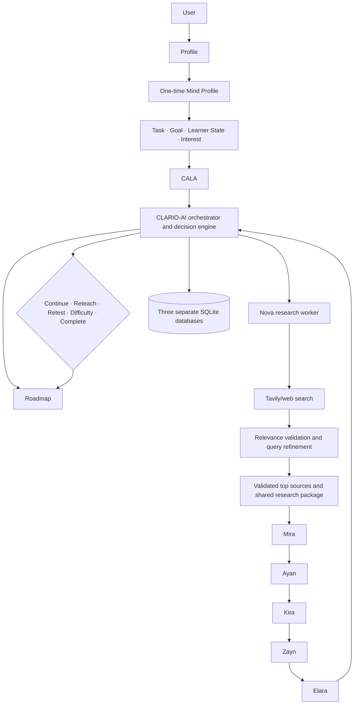

# CLARIO V2 Architecture

The latest CLARIO V2 Master Prompt supersedes older NOVA-centric architecture documents.

## Target system

### Ownership

- **CLARIO-AI** owns the state machine, routing, learner state, roadmap/level transitions, evidence aggregation, and final action.
- **CALA** prepares a plan using the exact four session inputs and available profile/learner evidence.
- **Nova** gathers and structures research; it does not orchestrate.
- **Mira, Ayan, Kira, Zayn, Elara** are isolated specialist workers. Elara evaluates evidence, while CLARIO-AI makes the final decision.
- The research source list must contain only validated real sources; target is ten when enough quality sources are available.
- Remediation is concept-scoped, adaptive, and followed by a distinct retest. It never restarts the full journey.

## Current implementation versus target

| Area | Current implementation | Target still required |
|---|---|---|
| Frontend | React 18, TypeScript, Vite; `main.tsx` → `App.tsx`; API client and React Context auth state. Onboarding displays CALA roadmap and research package/source links. | Dedicated learning source rail, interactive lesson UI, persisted mastery/reward experience. |
| Backend | FastAPI routes, Pydantic schemas, SQLAlchemy repositories/models. CALA, CLARIO-AI state, worker/evaluation attempts, decisions, concept performance, and adaptive execution status are persisted. | Ayan/Kira answer capture/grading; secure authenticated identity. |
| Orchestration | `ClarioAIOrchestrator` loads saved CALA context, dispatches Nova/Mira/Ayan/Kira/Zayn/Elara, applies deterministic post-evaluation rules, and executes persisted reteach/retest decisions for the same concept. Elara only evaluates; CLARIO-AI alone decides. | Full multi-level curriculum and progression. |
| Workers | Nova is bounded Tavily research; Mira teaches; Ayan creates an unanswered reasoning prompt; Kira creates an unanswered practical activity; Zayn creates the quiz; Elara evaluates teaching coverage and submitted quiz evidence. Ayan/Kira learner responses remain unavailable and are not fabricated. Generic older worker implementations remain under `backend/app/`; legacy `NovaOrchestrator` remains in older routes. | Ayan/Kira answer capture/grading and future adaptive decisions. |
| Planning/adaptation | CALA deterministically estimates an initial level and builds a persisted roadmap with Level 1 unlocked; CLARIO-AI owns the current CALA-to-research-to-teaching-to-thinking-to-practical flow. | CLARIO-AI-owned durable learner progression and later-level unlock policy. |
| Research | Backend Tavily adapter; up to three bounded queries; URL/content/relevance filtering, ranking, domain cap, max ten; one session-owned `SharedResearchPackage`; no fabricated fallback sources. | Automated query refinement and stronger evidence/quality validation. |
| Storage | One SQLite URL/engine and migrations 001–013; migration 013 enables attempt-keyed worker/evaluation rows and creates `clario_adaptive_executions`. Legacy account-profile `concept_performances` remains separate. Quiz answer keys stay private. | Three separate SQLite databases with explicit ownership, ID/reference and migration strategy. |

Current source of truth is `frontend/src/main.tsx`, `frontend/src/App.tsx`, and `backend/app/main.py`. This document describes target architecture separately from working code; target-only capabilities must not be claimed as implemented.

## Stack

- Frontend: React, TypeScript, Vite, Tailwind CSS.
- Backend: Python, FastAPI, Pydantic, SQLAlchemy.
- Current persistence: SQLite.
- Current AI provider factory: Gemini when configured; mock fallback. Other provider settings documented historically are not supported by the active factory.
