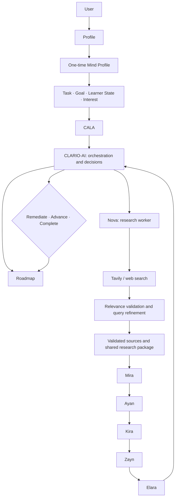

# CLARIO V2

CLARIO is an interactive learning product intended to adapt learning plans and support to the learner's goals, current state, interests, and demonstrated mastery. The **CLARIO V2 Master Prompt** is the product and architecture authority. Older specifications are superseded wherever they conflict with it.

## Target architecture



CLARIO-AI alone owns the overall learning journey and transitions. Nova, Mira, Ayan, Kira, Zayn, and Elara are specialized workers; they do not independently orchestrate the learner.

## Current implementation snapshot

This repository contains a working early vertical slice, not the complete target product:

- Email/password registration and login, with password hashing; Google OAuth is not configured.
- Personal profile setup and a persistent, one-time five-answer Mind Profile.
- A new learning form with exactly four session inputs: Task, Goal, Learner State, and Interest.
- Inputs persist independently per learning session; extra input fields are rejected.
- A development Decision Trees curriculum and a legacy-shaped FastAPI/SQLAlchemy learning backend.
- A deterministic, structured CALA planning endpoint. It infers an initial learner estimate from explicit session evidence, keeps unknown confidence/weakness unknown, and stores a session-specific Level 1 roadmap with future levels locked.
- A persisted CLARIO-AI orchestration foundation between CALA and research, with deterministic session states and a Nova task-dispatch boundary.
- A bounded Nova research worker: up to three Tavily searches, deterministic source validation/ranking, and a session-owned shared research package with up to ten validated sources.
- A Mira teaching worker called only by CLARIO-AI, using the saved CALA plan, learner context, and SharedResearchPackage to return typed teaching content with validated source references.
- An Ayan critical-thinking worker explicitly dispatched by CLARIO-AI after Mira. It generates a structured reasoning prompt grounded in Mira's lesson and verified source references; it does not collect or grade an answer.
- A Kira practical worker explicitly dispatched by CLARIO-AI after Ayan. It generates a structured real-world scenario and task from CALA, Mira/Ayan results, and same-session research context; it does not assess learner responses or decide progress.
- A Zayn quiz worker dispatched by CLARIO-AI after Kira. It generates five questions at CLARIO-AI-selected difficulty; the server stores the answer key separately and keeps learner-facing quiz/submission responses free of answers and explanations.
- An Elara evaluation worker dispatched by CLARIO-AI after quiz submission. It calculates quiz performance from server-stored answers, evaluates the current concept, and reports unavailable Ayan/Kira learner-response evidence explicitly. Elara does not decide progression or remediation.
- CLARIO-AI applies explicit deterministic post-Elara rules: strong + accuracy ≥80% + confidence ≥0.70 satisfies concept mastery; weak evidence reteaches (and lowers only that concept's difficulty when signaled); insufficient evidence retests without mastery. The decision and session-owned concept performance are persisted; no worker makes the decision.
- Onboarding communicates only with CLARIO-AI and displays the research package, lesson, thinking prompt, practical activity, Zayn challenge, Elara evaluation, and learner-safe next action.
- A React, TypeScript, and Vite frontend. `frontend/src/main.tsx` is the entry point and `App.tsx` is the route root.
- A single SQLite database with SQL migrations 001–012, including persistent CALA plans, research packages, one orchestration state, Mira/Ayan/Kira worker results, a Zayn quiz with private answer key/submission evidence, one Elara evaluation, session concept performance, and CLARIO-AI decision records. The existing legacy `concept_performances` table remains separate. This is not the target three-database architecture.
- Legacy `NovaOrchestrator` and generic specialized-agent implementations remain in older learning routes; the new CALA-to-research path is CLARIO-AI controlled.

The current account/session path now creates the learner-profile persistence anchor needed by concept-performance records. Its old compatibility fields record the first learning goal/interest and Mind Profile explanation preference; current level is marked `unassessed`, and initial confidence uses `0` as an unknown sentinel. These values are not a dynamic learner model.

### Known limitations

- User identity is represented in the browser by a local-storage user ID; there is no secure server-issued session/token flow. Google OAuth is disabled.
- CALA currently provides only initial deterministic planning and a Level 1 roadmap; it is not the complete adaptive learner model. CLARIO-AI owns the persisted CALA-to-research-to-Mira-to-Ayan-to-Kira-to-Zayn-to-Elara path and deterministic post-Elara decisions. Query refinement and Nova's autonomous source retrieval are not implemented.
- Research uses actual Tavily results when `TAVILY_API_KEY` is configured. Invalid or irrelevant results are filtered; fewer than ten sources are returned when fewer pass validation. No sources are fabricated. The research package contains source metadata and retrieved excerpts, not independently verified facts or generated teaching content.
- The post-Elara decision and concept-performance foundation is implemented, but automatic Mira reteaching/retesting cycles, Ayan/Kira learner response capture/grading, later-level curriculum, three separate SQLite databases, persistent gamification, and final report are not implemented. Elara evaluates submitted quiz performance and teaching coverage only; Ayan/Kira learner responses are explicitly unavailable. Roadmap advancement is conservative: only fully evidenced mapped concepts can complete a level; empty placeholder levels are not unlocked.
- The four inputs are used by CALA and passed through Nova's research request, Mira's teaching task, Ayan's thinking task, and Kira's practical task. Ayan and Kira do not collect or grade learner answers.
- Some dashboard reward values are placeholders.

## Run locally

Requirements: Python 3.12+, Node.js 18+.

Backend from the repository root:

```powershell
pip install -e .
python -m uvicorn backend.app.main:app --host 0.0.0.0 --port 8000
```

Frontend in `frontend`:

```powershell
npm install
npm run dev
```

Vite proxies `/api` to `http://localhost:8000`. Set `GEMINI_API_KEY` in `.env` to use Gemini; without a configured key the provider factory uses its mock provider.
Set `TAVILY_API_KEY` in the backend environment to enable real research searches. The rest of the application starts without it; a new research request returns a clear configuration error until it is set.

## Verification

```powershell
python -m pytest -q
Set-Location frontend
npm run build
```

Latest verification: full backend test suite passed (167 tests), frontend production build passed, and migration 012 fresh/rerun safety is covered by passing migration tests.

## Documentation

- [AGENTS.md](./AGENTS.md): worker roles and orchestration boundaries.
- [PROJECT.md](./PROJECT.md): product vision and learner flow.
- [ARCHITECTURE.md](./ARCHITECTURE.md): target architecture versus current implementation.
- [API.md](./API.md): current API routes and unfinished target contracts.
- [DATABASE.md](./DATABASE.md): current single-database schema and target separation gap.
- [IMPLEMENTATION_PLAN.md](./IMPLEMENTATION_PLAN.md): verified completion and controlled next slices.
- [docs/](./docs): focused architecture notes and historical decisions.
